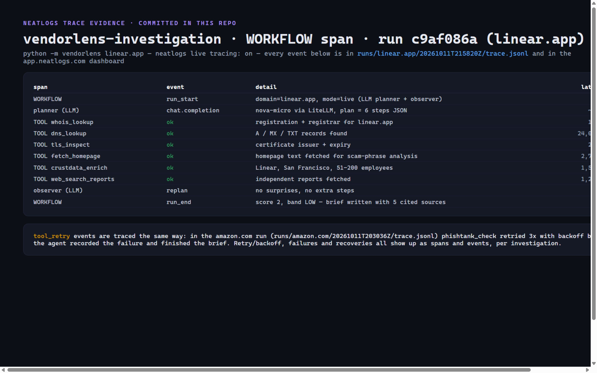

# VendorLens: AI vendor due-diligence agent

Built solo for **neatHack 2026** (team `solohackaton`). Give it a company
domain; an AI agent plans an OSINT investigation, executes tools step by
step, adapts and recovers from failures, verifies claims across sources, and
writes a **cited risk brief**: a 0-100 score, layered evidence, a confidence
tag per claim, and links to the public source behind every signal.

## Demo

- **Live demo page:** https://vendorlens-demo.pages.dev — enter a company name
  or domain; the page invokes the deployed agent (AWS Lambda) for a fresh
  investigation, then the Bekko 17m typed-decision model scores the returned
  homepage text **in the browser** (zero network after the ~29 MB of weights
  load; that text never leaves the device). The page is live-only — no canned
  replay; build/deploy steps in [`demo/README.md`](demo/README.md).
- **Demo video (2:58, covers neatlogs + Entire + cfo.ai):**
  - `docs/demo.mp4`: https://github.com/warsang/vendorlens/blob/main/docs/demo.mp4
  - release asset (streamable/downloadable):
    https://github.com/warsang/vendorlens/releases/tag/demo
  - built from `docs/video-slides.html` with `python docs/build_video.py`
    (headless slides + SAPI narration + ffmpeg); re-run it to rebuild the mp4
- **Storyboard + timings:** `docs/demo-script.md`

## Quickstart

```bash
pip install -r requirements.txt
cp .env.example .env          # keys optional; --demo needs none

python -m vendorlens acme-cloud-services.example --demo            # canned, zero keys
python -m vendorlens stripe.com --no-llm                          # live tools, no LLM key
python -m vendorlens example-vendor.com                           # full LLM-planned run (needs LITELLM_*)
```

Flags: `--scenario <suspicious|legit|young_startup>` for canned stories,
`--inject-failure <tool>[:n]` to demo failure -> retry -> recovery, and
`--tag <name>` to label a run. Artifacts land in
`runs/<domain>/<timestamp>/`: `brief.md`, `state.json`, `trace.jsonl`.

## Evidence (committed, verifiable)

Real briefs + traces live in [`examples/`](examples/README.md):

| Example | Mode | Verdict | What it proves |
|---|---|---|---|
| [`examples/stripe.com`](examples/stripe.com/brief.md) | live | LOW 0/100 | Established vendor: long cert history, DMARC enforced, HSTS/CSP, all cited |
| [`examples/github.com`](examples/github.com/brief.md) | live | LOW 0/100 | Same, from live OSINT with no keys |
| [`examples/suspicious-acme.example`](examples/suspicious-acme.example/brief.md) | canned | CRITICAL 100/100 | Young domain + PhishTank/urlscan listings + self-signed cert + scam copy |
| [`examples/young-startup.example`](examples/young-startup.example/brief.md) | canned | MEDIUM 29/100 | The borderline case near the LOW/MEDIUM boundary |
| [`examples/injected-failure-acme.example`](examples/injected-failure-acme.example/trace.jsonl) | canned | CRITICAL | Failure -> retry -> recovery visible in `trace.jsonl` |

Offline eval (re-scores the committed runs, no network):

```bash
python -m vendorlens.eval       # confusion table + accuracy over examples/
python -m pytest                # 60+ unit/regression tests
python examples/_regen.py       # regenerate the committed examples
```

Every signal, weight and rationale is listed in [`docs/scoring.md`](docs/scoring.md).

## What changed, with evidence

Every row links to a committed `trace.jsonl` / `state.json` (raw archives
under [`runs/`](runs/README.md)) or a corrected brief under `examples/`. Live
source counts drift between runs, so treat any single score as one heuristic
result, not a fixed number.

| Improvement | Before | After (committed evidence) |
|---|---|---|
| Citations resolve to the signal's own source | earlier briefs numbered sources per signal, so every row cited `[1]` (`tests/test_brief.py` is the regression guard) | `examples/*/brief.md`: each `[n]` maps to that signal's own source |
| The corroboration discount is honest | it fired on any one signal and named evidence that had not run | `risk.py` requires >= 2 independent tools and names only what fired (`tests/test_risk.py`); see `examples/stripe.com/brief.md` |
| Retry only what can change, and log recovery | `runs/amazon.com/20261011T203036Z/trace.jsonl`: fixed sleeps retried even a deterministic "feed too large" error | `examples/injected-failure-acme.example/trace.jsonl`: a classified transient failure retries with jitter and a cap, then emits `tool_recovered` |
| Adaptive, capped replanning | fixed plan only | `examples/suspicious-acme.example/trace.jsonl`: a `replan` event adds the phishing-feed check because the domain is young |
| Claims are verified across sources | no cross-source check | `verify.py` tags corroborated / single-source / contradicted; the brief renders a Confidence column and a "What we could not verify" list (`examples/*/brief.md`) |
| A failing feed never aborts the run | `runs/example.com/20261011T091433Z/trace.jsonl`: `crustdata_enrich` fails (no key) and the run still completes | `examples/linear.app/brief.md` and the other live examples list failures under "What we could not verify" |

Sources for every number: `state.json` / `trace.jsonl` in the linked runs and
the briefs under `examples/`. The archived `linear.app` run is a historical
live LLM-planned run; its trace backs the neatlogs screenshot (its pre-fix
`brief.md` is not committed, see `runs/README.md`).

## How it works

```
                     +-------------------+   JSON plan generated from the live
                     |   planner (LLM)   |   TOOLS registry (falls back to a
                     +--------+----------+   deterministic 8-tool plan)
                              |
                     +--------v----------+
                     |  executor + state |   one retry layer: only transient
                     +--------+----------+   errors retried (429/5xx/timeout),
                              |               deterministic failures recorded once
        +---------------------+---------------------+
        |                     |                     |
 +------v------+       +-------v-------+      +------v------+
 | 11 tools    |       |  observer     |      |  risk       |
 | rdap/doh    |       |  LLM + rules  |      |  weighted   |
 | ct/urlscan  |       |  capped+dedupe|      |  + verify   |
 | phishtank   |       |  replanning   |      |  3 layers   |
 | homepage    |       +---------------+      +------+------+
 | crustdata   |                                |
 +-------------+                         +------v------+
                                       |  cited brief |
                                       |  brief.md    |
                                       +-------------+

 Every step -> neatlogs WORKFLOW + nested TOOL spans (LLM calls auto-traced)
               + trace.jsonl evidence
 Every commit -> Entire checkpoint (the agent session behind the change)
 Business plan -> cfo.ai (pricing, costs, revenue, runway, breakeven)
 Browser verdict -> jev-web typed-decision model, 100% on-device
```

Three data layers, so a buyer reads the brief as answers plus a
disqualifier watch:

1. **real & established** -- is this domain a real, operating business?
   (registration age, resolution + mail, SPF/DMARC, certificate history,
   company record, privacy/terms pages)
2. **security posture** -- is the vendor's hygiene mature? (TLS, HSTS/CSP,
   security.txt, DMARC enforcement)
3. **threat & reputation** -- active abuse signals. (PhishTank, urlscan
   verdicts, scam copy, vendor-scoped negative reports)

## The three mandatory tools

### 1. neatlogs (observability)

`vendorlens/tracing.py` follows the official setup guide: `neatlogs.init`
once, `neatlogs.wrap(OpenAI())` so every planner/observer/analyst call is
traced (model, messages, latency, tokens), one root `WORKFLOW` span per run
with a nested child span per tool step. Tool executions also land as
structured events in `runs/<domain>/<ts>/trace.jsonl` (the local mirror).
Signup is manual; the Project API key goes in `NEATLOGS_API_KEY`.
Dashboard project: `vendorlens-investigation` (https://app.neatlogs.com).
Committed live runs were made with `neatlogs live tracing: on`.

neatlogs trace evidence, rendered from the committed run
`runs/linear.app/20261011T215820Z/trace.jsonl`:



### 2. Entire (checkpoints)

The repo runs `entire enable --agent opencode` (hooks in `.git/hooks/`), so
each commit captures the agent session that produced it.

- **Checkpoint:** https://entire.io/gh/warsang/vendorlens/commit/3d5aab50787672851fdf76de5afa39b6e53e9f69
- **Checkpoint ID:** `ddf4ab1afdcaae3a8fd47d92a42039f6b891146d`
- Inspect with `entire checkpoint list` and `entire checkpoint explain HEAD`;
  setup and steps in [`entire/ENTIRE.md`](entire/ENTIRE.md).

### 3. cfo.ai (business plan)

Inputs are in [`docs/business-plan-inputs.md`](docs/business-plan-inputs.md)
(margins, unit economics, runway and breakeven are internally consistent).
The plan export lives at https://cfo.ai/neathacks.

## Honest limitations

- Weights are expert-chosen heuristics; the offline eval scores 7 labelled
  cached runs and domain classification is subjective near the LOW/MEDIUM
  boundary. See `docs/scoring.md`.
- `dns_lookup` (UDP/53), `whois_lookup` (TCP/43) and `tls_inspect` (direct
  TCP/443) need unrestricted internet and fail gracefully in restricted
  sandboxes; `doh_dns` and `rdap_lookup` are their keyless HTTPS successors.
- `httpx` honors proxy env vars. If you hit `Invalid port: ':1]'`, your
  `no_proxy` contains `[::1]`, which httpx misparses; override with
  `export no_proxy='localhost,127.0.0.1,::1,198.19.0.1,198.19.0.2'`.
- `--inject-failure` is a fault injection flag for demoing recovery.
- The public endpoint treats `x-api-key` as a **public client token** (rate
  attribution), not authentication; protection is external rate limiting, a
  spend budget, and a pinned `ALLOWED_ORIGIN`. The deployed live endpoint
  (function `vendorlens-agent`, HTTP API `gxqk0fcwne`) is what the public demo
  page invokes; setup and re-deploy steps in
  [`deploy/README.md`](deploy/README.md).

## Building in public

Drafted posts live in [`docs/build-in-public.md`](docs/build-in-public.md);
posting is human-approved only. The three #neatHack posts (kickoff, mid-hack
retry/backoff update, submission) go out from X before the Oct 12
7:00-11:55 PM IST window; their links go here on posting:

1. Kickoff (Sat, Oct 10) - link to be added on posting.
2. Mid-hack update (Sat evening, Oct 10) - link to be added on posting.
3. Submission post (Oct 12, in the submission window) - link to be added on posting.

## License

MIT, see [`LICENSE`](LICENSE).

## Submission

- Public repo: `warsang/vendorlens` (commits Oct 10-12, 2026).
- The planned submission is a quote post of the official neatlogs X post
  inside the Oct 12 7:00-11:55 PM IST window, pointing at team `solohackaton`,
  this repo, the demo page and the evidence linked above.
